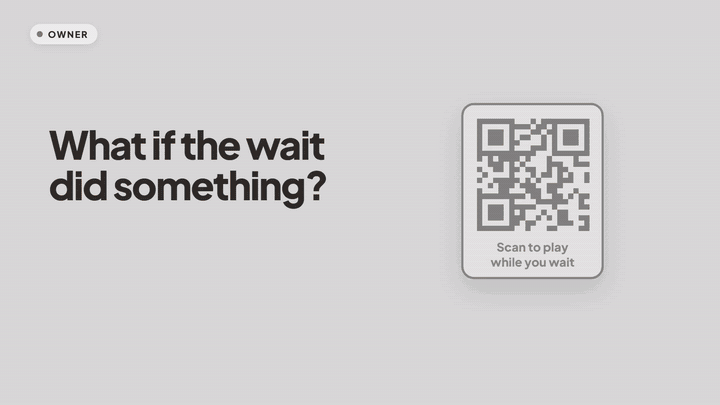
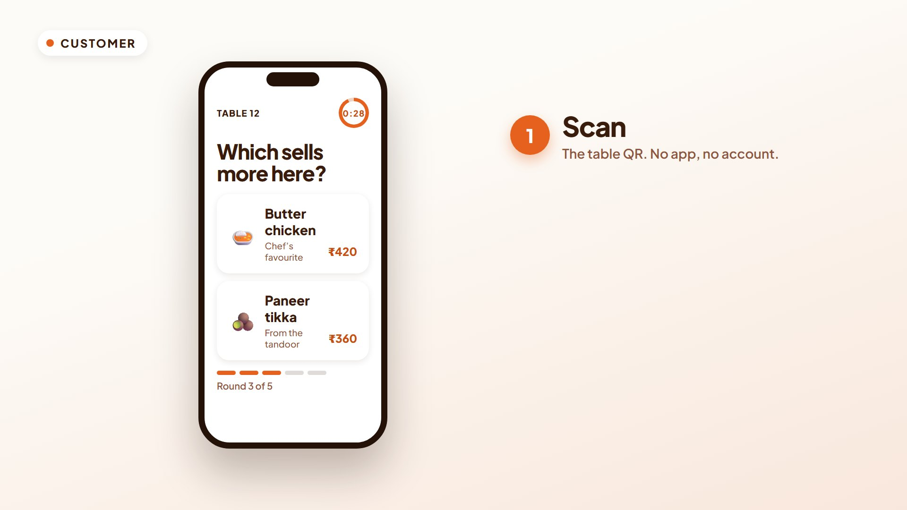
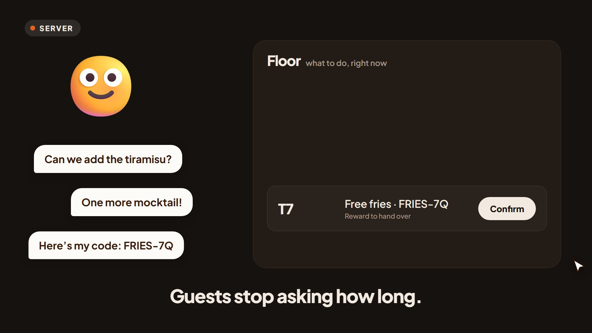
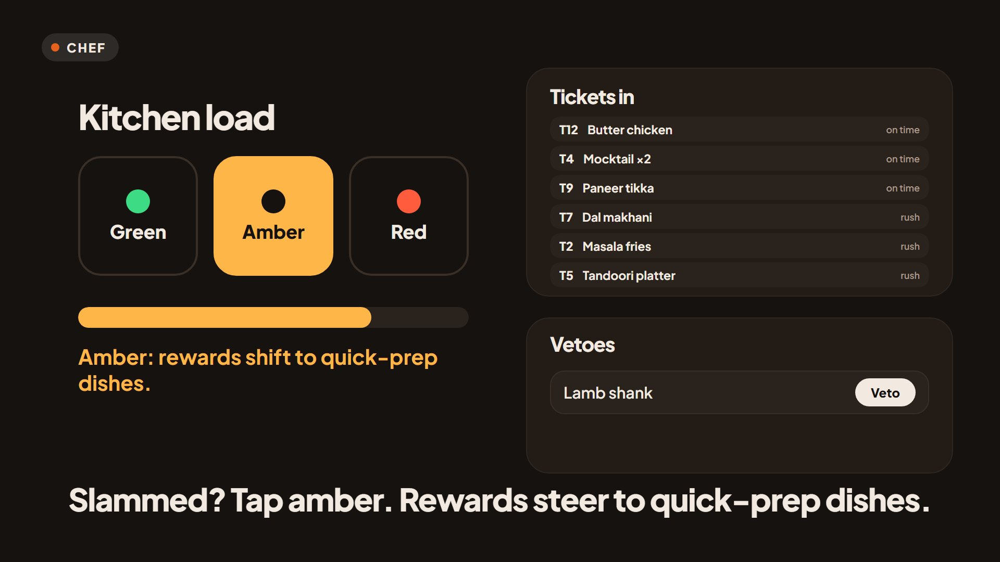
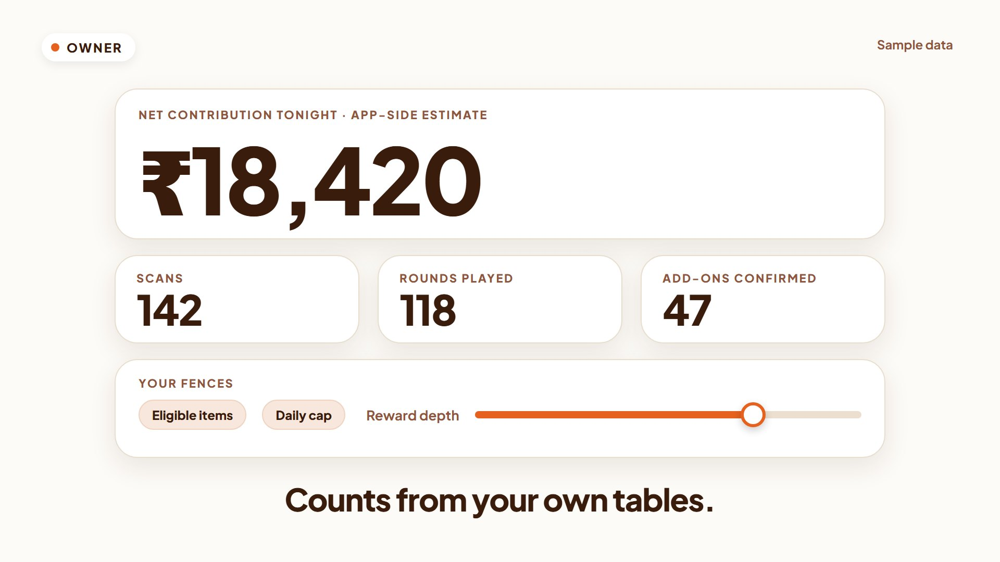
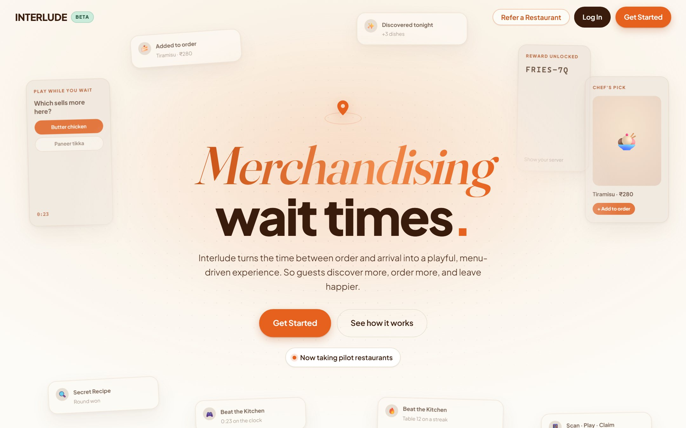
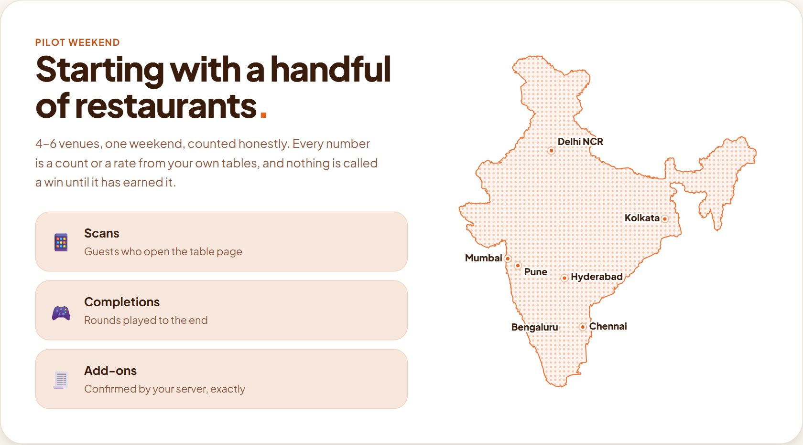
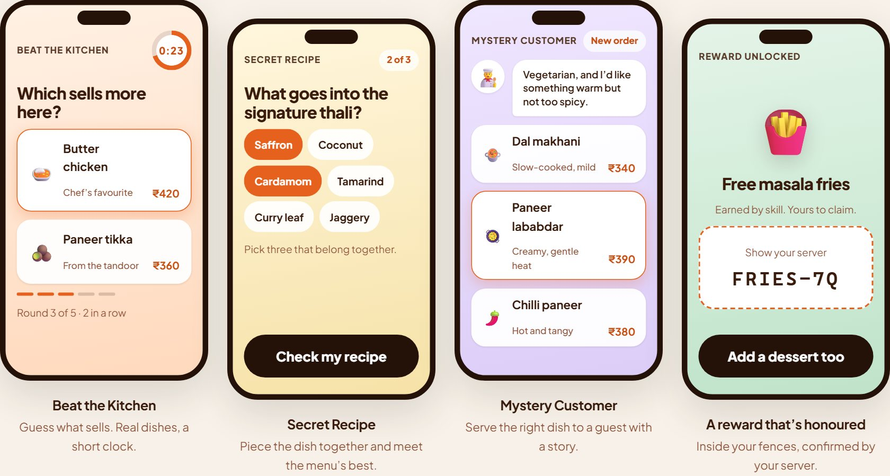
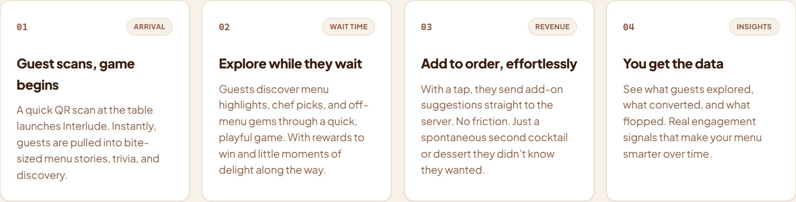
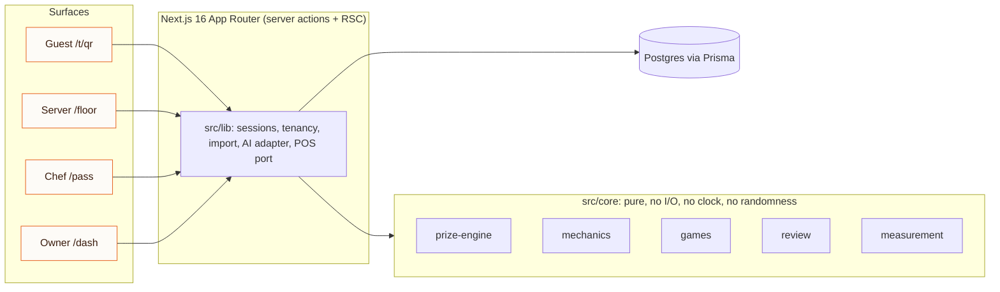

# Interlude

**Merchandising wait times.** Interlude turns the minutes between "order placed" and "food arrives" into a quick, food-native round at the table, so guests discover more of the menu, order more, and leave happier. No app, no account, no payment processing. A QR on the table is the whole install.

<p align="center">
  <a href="docs/media/Interlude-product-showcase.mp4">
    
  </a>
</p>

<p align="center">
  <b><a href="docs/media/Interlude-product-showcase.mp4">▶ Watch the full Interlude product showcase (78 s, with sound)</a></b>
</p>

<sub>One Saturday night at Table 12, told from four seats: guest, server, chef, owner. It starts grey and flips to colour when the QR is scanned. The preview above loops the turning point; the full film is 6.7 MB. Numbers on screen are labelled sample data.</sub>

---

## Contents

1. [The problem and the bet](#the-problem-and-the-bet)
2. [One night, four seats](#one-night-four-seats)
3. [What you can see today](#what-you-can-see-today)
4. [Product decisions that are not negotiable](#product-decisions-that-are-not-negotiable)
5. [Architecture](#architecture)
6. [Measurement: how we avoid fooling ourselves](#measurement-how-we-avoid-fooling-ourselves)
7. [Quality and security](#quality-and-security)
8. [Status, honest edition](#status-honest-edition)
9. [Local setup](#local-setup) · [Verification](#automated-verification) · [Deployment](#production-deployment)

---

## The problem and the bet

Every restaurant has dead time. The guest has ordered, the kitchen is cooking, and for ten to twenty minutes the table is idle: phones come out, servers get asked "how much longer?", and nothing is sold. That time belongs to nobody.

**The bet:** that time is the best merchandising slot a restaurant has. The guest is seated, attentive, and about to be hungry for one more thing. A short skill game built from the venue's *own* menu puts dishes in front of them at that moment. A reward they earn is a real dish the owner has pre-approved. One tap sends an add-on to the server.

The product has to be right for four people at once, which is what makes it interesting:

| Who | What they need | What Interlude gives them |
| --- | --- | --- |
| **Guest** | Something better than scrolling, with zero friction | A 30-second round on their phone from a QR scan, a reward earned by skill, one tap to add a dish |
| **Server** | Fewer "where's my food?" questions and no extra screens to manage | One list: what to do, at which table, right now |
| **Chef** | A kitchen that is not slammed by add-ons at the worst moment | One kitchen-load control and a veto list; rewards and picks steer around what is busy |
| **Owner** | Proof it pays, without being lied to | One headline number, honest counts, and hard limits on what can ever be given away |

## One night, four seats

| Guest | Server |
| --- | --- |
|  |  |
| Scan, play Beat the Kitchen, earn a reward, add a dessert. | A ticket lands, one tap confirms it. Guests now ask to *order*. |

| Chef | Owner |
| --- | --- |
|  |  |
| A rush hits, the chef taps Amber, rewards shift to quick-prep dishes. | One number, labelled as an estimate, plus the fences the owner controls. |

<sub>Stills are from the product showcase film and show sample data. They illustrate the flows below; they are not screenshots of a live venue.</sub>

## What you can see today

The public front door is a single zero-client-component page that explains the product in an operator's language.



| | |
| --- | --- |
|  |  |



<sub>The landing's stat cards, testimonials and city pins are illustrative placeholders (see [Status](#status-honest-edition)). Replace them with pilot data before going live.</sub>

### Surfaces

Four audiences, four deliberately different design contracts. Building the wrong one into a route is a real failure mode, so the contracts are written down in [`UI-SPEC.md`](UI-SPEC.md).

| Route | For | Contract |
| --- | --- | --- |
| `/` | Owner, not yet signed up | Front door. Zero client components beyond a small enhancement island |
| `/v/[venueToken]` → `/t/[qrToken]` | Guest | Venue QR, pick your table, then play. Anonymous, no account |
| `/floor/[venueSlug]` | Server | Never shown a metric. Only what to do, where, right now |
| `/pass` | Chef | One control (kitchen load) and one list (vetoes). Glanceable with wet hands |
| `/signup` → `/onboarding` → `/dash` | Owner | Self-serve six-step setup ending in a printable QR; the dashboard leads with one number |
| `/dash/menu`, `/prizes`, `/games`, `/import`, `/feedback`, `/settings`, `/tents` | Owner | The venue's own menu and fences. Every field writes config, never a constant |

Auth is split cleanly and stays split: **guests** have none, **staff** hold a venue PIN, **owners** hold an operator session. A staff PIN never reaches a metric, and an operator session is never required to fire an order.

## Product decisions that are not negotiable

These are the reasons the product is defensible and legal. They are enforced in code, not just written here.

**No pure chance, anywhere.** `Math.random` and `crypto.getRandomValues` are banned by ESLint inside `core/prize-engine` and `core/mechanics`. Outcomes are a pure function of skill input. The mystery plate is a fixed-price product the guest wins the *right to buy*, never a draw or a wheel. This is a gambling-law line, not a design taste.

**Every reward decision explains itself.** The prize engine returns a `reason` for each decision and snapshots the whole pool per service to a `PrizePool` row. That audit trail is the promise to the operator: *we optimise inside your fences.*

**Reviews are structurally separate from rewards.** The review module is given no prize or award state, enforced as a module boundary. It stores funnel counts only (shown, drafted, handed off) and never a rating, because storing sentiment would create the ability to gate on it. The prompt fires for 100% of sessions regardless of play, win or sentiment.

**Loyalty is per venue and cross-venue identity is impossible by construction.** A phone number is only ever asked *after* a round. It is normalised, HMAC'd with a per-venue salt, and discarded; only the hash is stored. The same number is two unrelated identities at two venues. There is deliberately no operator-side phone lookup: a one-way hash plus a search box is a re-identification oracle.

**AI reads and drafts; a person confirms; it never decides.** It lives behind an adapter with a mock, is import-banned from `core/`, and does four narrow jobs: menu extraction from a photo or PDF, weekly report narration, review drafts the guest approves, and item descriptions. It never picks a prize, a pair or an outcome, never writes a food cost (a hallucinated cost would become a wrong contribution number shown as fact), never reads a rating, and never sits on the guest's critical path.

**Numbers are configuration, not constants.** Prep times, margin bands, prize depth caps, the mystery-plate price, climb rungs, countdown buffer, peak hours and every gate are venue config seeded from an estimate and editable in `/dash`. The validation tests have not run, so when real numbers arrive we edit config, not code.

**Nothing depends on a vendor POS API existing.** Work goes through a `PosAdapter` port. `Manual` and `CsvImport` ship; Petpooja and Restroworks are interface-conforming stubs with no live calls.

**Multi-tenant from the first query.** Every operator query takes its `venueId` from the session via `requireOperator()`, never from a URL or form field. A route that accepts a venue id from the client is a cross-tenant leak that types will not catch.

**Never built, including under new names:** XP, levels, badges, global leaderboards, cross-venue identity, accounts-before-value, spin wheels and scratch cards, incentivised or gated reviews, payment processing, discounts on hero items, native apps.

## Architecture



**`core/` is pure.** `prize-engine`, `mechanics`, `games`, `review` and `measurement` take everything as arguments: no database, no clock, no randomness. That purity is what makes the compliance invariants *testable*, including with property tests. A purity test (`src/core/purity.test.ts`) fails the test run if I/O leaks in.

**Realtime is polling, not websockets.** Venue wifi is unreliable and serverless does not hold sockets. Intervals are per-surface, not a blanket 2s: 5s waiting for an order to fire, none mid-round, 3s awaiting redemption, 2s on `/floor`, 10s on `/pass`, all paused when the tab is hidden. The countdown is driven by a **server-issued end timestamp**, so client clock skew and tab-suspend cannot desync a round. Animation is local; truth is server-side.

**A measured payload budget.** The guest route ships ~184.5 KB gzipped, almost all of it React's hydration floor on the App Router (an empty page is 181.7 KB). The enforceable rule is that *our own code adds at most 15 KB over that floor*, with a 200 KB regression ceiling, measured by `scripts/measure-guest-payload.mts`. We chose to measure and revise an unreachable "under 100 KB" target rather than pretend.

| Layer | Choice |
| --- | --- |
| Framework | Next.js 16 (App Router), React, TypeScript strict |
| Data | PostgreSQL + Prisma (`@prisma/adapter-pg`), 36 models |
| Hosting | Vercel (incl. Cron), pinned to `sin1` near the Neon database |
| Email | Resend (console transport in dev) |
| AI | Gemini behind an adapter, with a deterministic mock |
| Validation | Zod at trust boundaries |
| Tests | Vitest (unit and property) · Playwright (E2E, Pixel 7 viewport) |

```text
src/
  core/            pure domain logic (prize-engine, mechanics, games, review, measurement)
  lib/             server-side services: sessions, tenancy, import, AI adapter, POS port
  app/             routes: (guest) (staff) (kitchen) (operator) and the landing
  strings/         all user-facing copy (English first; Hindi is a translation job)
prisma/            schema + migrations + seed
e2e/               Playwright specs
docs/              deploy runbook, revamp brief and notes, product-showcase media
scripts/           payload measurement, pilot report, env checks
```

## Measurement: how we avoid fooling ourselves

The north-star is **attach-rate delta**: how much more of an order is add-ons at tented tables than untented ones.

- **Arm assignment is a recorded row, never a computed guess.** `TableArmAssignment` (service, table, arm, swapAt) is the entire evidentiary basis of the business. It is auditable and cannot be reconstructed favourably after the fact. Control tables cannot open a session, and that is tested.
- **Two deltas, one honest headline.** *ITT delta* (all tented vs all untented) is the headline. *Engaged delta* (scanned vs untented) includes self-selection and only ever appears with that caveat.
- **Two tiers, never merged.** Until the first POS bill export lands there is an **app-native tier**: add-on gross, contribution, prize cost, and net contribution computed from confirmed rows against the venue's own margin config, always labelled an app-side estimate. Tier 2 takes the headline when the first export lands.
- **We do not show a result before it earns it.** The pilot is 4–6 venues on one weekend because one venue cannot produce a defensible delta. The dashboard sells on exact counts and rates with confidence intervals, and says "not yet conclusive" until the interval excludes zero (`PLATFORM.md` §9a).

## Quality and security

- **Unit and property tests:** 634 Vitest tests, including property tests over the prize engine's invariants and a purity test over `core/`.
- **End-to-end:** 18 Playwright spec files covering onboarding, tenancy, the three games, loyalty, review hand-off, bill import, the dashboard and the landing's copy rules (for example, it must never imply a draw, wheel or lottery).
- **Tooling that enforces rules:** a `server-only` build guard on the database module, an ESLint rule that makes secret-shaped `NEXT_PUBLIC_*` reads an error, and the randomness ban above.
- **Security model:** documented control by control in [`SECURITY.md`](SECURITY.md), including the deliberate, written-down trade-off of email-and-password owner sign-in until a sending domain is verified (the magic-link path is dormant, not deleted).
- **Accessibility and motion:** the UI honours `prefers-reduced-motion` and `prefers-reduced-transparency`; colour is information (saturated colours are reserved for status, so a loss can never be mistaken for a button).

## Status, honest edition

**Shipped:** the guest, staff, kitchen and operator surfaces run end to end, including self-serve onboarding, three games (Beat the Kitchen, Secret Recipe, Mystery Customer), loyalty, review hand-off, private feedback, bill import and a weekly report cron.

**Open, and said plainly:**

- **Deploy:** blocked on an account, not on code. The runbook is [`docs/DEPLOY.md`](docs/DEPLOY.md).
- **Real data:** the bill parser has not yet run against a real venue export, and the voice path on the review screen is typed-only for now.
- **Landing content:** the stat cards, testimonials, city pins and sample dish prices are illustrative. The pilot has not run, so nothing there is evidence. Replace before going live.
- **Real-device checks:** brightness at 20%, haptics (Android-only), and the degradation drills are owed before launch.
- **Design decision owed:** the shipped pairing in `core/game/pairing.ts` has no winner-stays; the analysis and three options are in [`docs/REVAMP-NOTES.md`](docs/REVAMP-NOTES.md).

**Where it goes next:** run the 4–6 venue pilot weekend, publish counts and rates with intervals, import the first real bill export, then take up Hindi and a shared screen (both explicitly V1.5).

---

## Local setup

Requirements: Node.js 20+ and a PostgreSQL database (Neon Postgres is the production target).

```bash
npm ci
Copy-Item .env.example .env
```

Set at least `DATABASE_URL`, `DIRECT_URL`, `SESSION_SECRET`, and `APP_BASE_URL` in `.env`. For local development, email logs to the terminal when no Resend key is configured and menu extraction uses the deterministic mock when no Gemini key is present.

Create the local development schema and demo data:

```bash
npm run db:push
npm run db:seed
npm run dev
```

The seed resets its target database. Use it only with a dedicated local/development database, never with pilot or production data. It creates two demo venues:

| Surface | Pilot credentials |
| --- | --- |
| Operator | `owner@example.com` / `pilot-owner-dev` |
| Floor | `/floor/pilot` — PIN `1234` |
| Kitchen | `/pass` — PIN `5678` |

Change the seed credentials before using any non-development database.

## Automated verification

Run these before handing off a change:

```bash
npm run format:check
npm run lint
npm run typecheck
npm test
```

The Playwright suite runs a production build on a Pixel 7 viewport and directly arranges test state in the configured database. Start from freshly seeded **development-only** data, then run:

```bash
npm run test:e2e
```

It starts `next start` on port `3200`; set `E2E_BASE_URL` only when targeting an already-running test instance. The suite uses `EMAIL_TRANSPORT=console` and `AI_TRANSPORT=mock` only for its isolated test build. Never set either variable in a deployment.

## End-to-end acceptance checklist

Use this as the real-device pass after the automated suite. Do it against a safe test venue; not against an active measurement weekend.

1. On a phone, open `/signup`, complete the six-step onboarding, and generate a printable QR.
2. Confirm the sign-in email is delivered. In production, its sender domain must be verified in Resend.
3. Scan the venue QR, choose a table, then scan the table QR from **printed paper**. Play a round, lock and unlock the phone, and confirm the server-timestamp countdown remains correct.
4. Check `/floor/[venueSlug]` with the floor PIN and `/pass` with the kitchen PIN. Change kitchen load, add a veto, and confirm the guest offering respects both.
5. Exercise the bill-wait routes: review hand-off, private feedback, and (if enabled) loyalty phone capture.
6. Upload one representative POS export at `/dash/import` and inspect the dashboard and activity/refusal logs.
7. Call the weekly-report route with its bearer secret and verify its JSON response before relying on Monday's cron.

For production-specific rules and the exact cron command, follow [the deployment runbook](docs/DEPLOY.md). In particular: choose the final HTTPS origin before printing QR tents, do not seed production, and do not run a fake game through a pilot database because it affects pooled pilot reporting.

## Production deployment

Vercel builds with `npm run check:env && prisma generate && prisma migrate deploy && next build`. Configure the production variables described in [docs/DEPLOY.md](docs/DEPLOY.md): pooled `DATABASE_URL`, unpooled `DIRECT_URL`, `SESSION_SECRET`, final `APP_BASE_URL`, Resend credentials, and `CRON_SECRET`; `GEMINI_API_KEY` is optional.

The deployment is pinned to Singapore (`sin1`) to sit near the intended Neon database. Do not set `EMAIL_TRANSPORT` or `AI_TRANSPORT` in Vercel.

## Useful commands

```bash
npm run dev             # local development server
npm run build           # production build
npm run start           # serve a production build
npm run check:env       # validates deployment variables when VERCEL_ENV is set
npm run db:generate     # regenerate Prisma client
npm run db:migrate      # create/apply a development migration
npm run db:studio       # inspect the configured database
```

## Documentation

- [Platform reference](PLATFORM.md)
- [Production deployment runbook](docs/DEPLOY.md)
- [Security notes](SECURITY.md)
- [Execution checklist](TODO.md)
- [UI contract](UI-SPEC.md) · [UI revamp brief](docs/REVAMP-BRIEF.md) · [revamp notes](docs/REVAMP-NOTES.md)
- [Product showcase film and screenshots](docs/media/)
